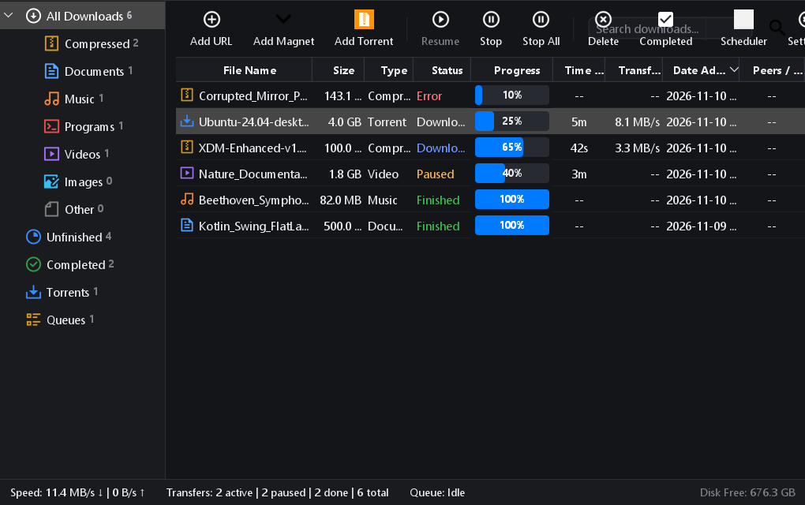
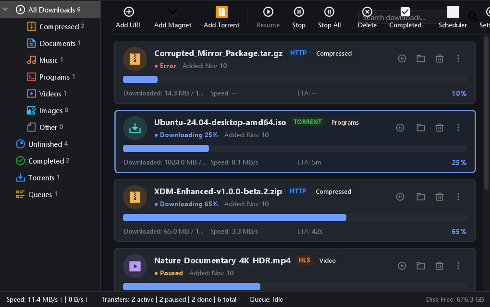
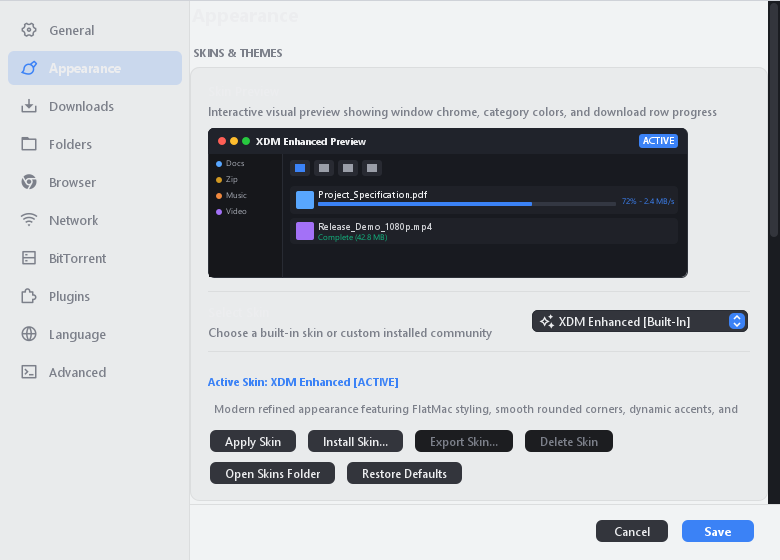
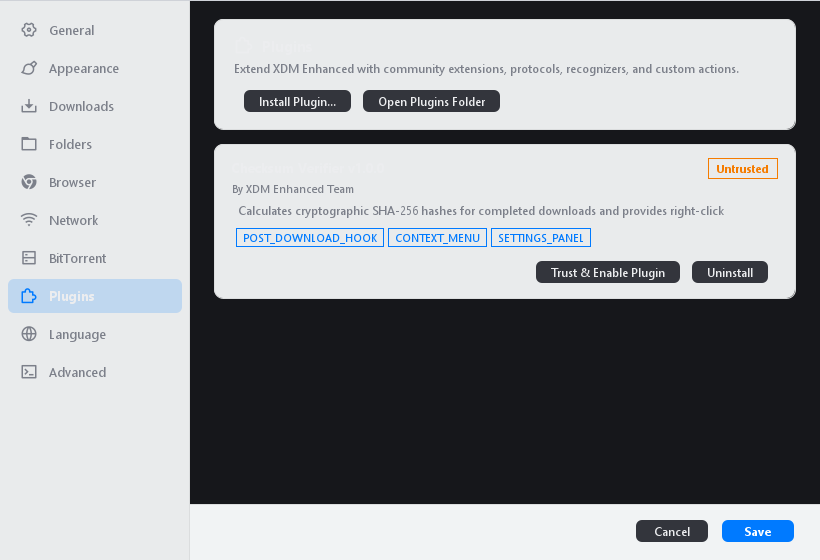
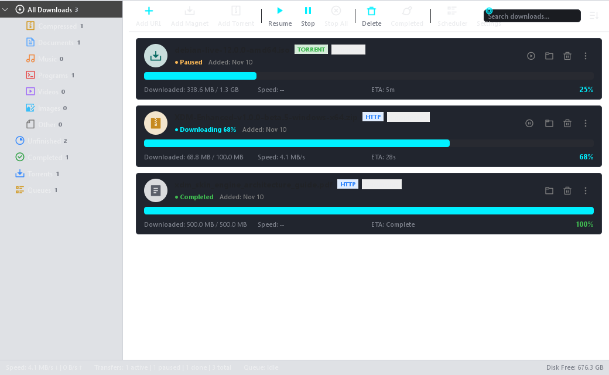
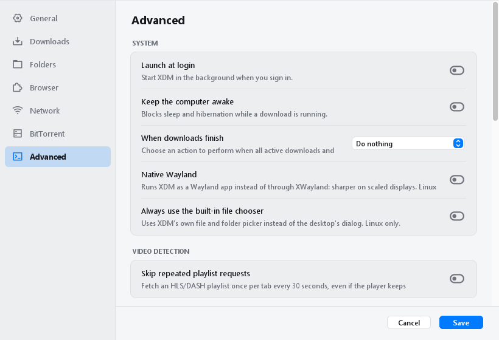

<p align="center">
  
</p>

# XDM Enhanced

**An independent, open-source download manager focused on speed, reliability, and modular extensibility.**

<p align="center">
  <a href="https://github.com/jakepanlilio2000/XDM-Enhanced/releases"></a>
  <a href="https://github.com/jakepanlilio2000/XDM-Enhanced/releases"></a>
  
  <a href="LICENSE"></a>
  
</p>

---

**XDM Enhanced** is an independently maintained, open-source desktop download manager forked from [Xtreme Download Manager (XDM)](https://github.com/subhra74/xdm). It pairs high-speed multi-connection segmented HTTP/HTTPS downloading and streaming media capture with native BitTorrent and magnet support, modern FlatLaf dynamic theming, custom skin packages, a decoupled Java plugin framework, automated post-download rules, power management, and companion browser extensions.

The original upstream documentation is preserved in [README.UPSTREAM.md](README.UPSTREAM.md).

---

## Features

### 1. Download Management
- **Multi-Connection Dynamic Segmentation:** Splits transfers into concurrent byte streams that assemble directly on disk without secondary copy overhead.
- **Resumable Transfers:** Automatically resumes interrupted downloads caused by network timeouts, connection drops, or computer restarts.
- **Pre-Flight Link Refresh:** Refreshes expired temporary URLs and re-authenticates without losing previously downloaded segments.
- **Bandwidth Control:** Configurable global and per-task transfer rate limits to prevent network congestion.
- **Task Scheduling & Queues:** Sequential and parallel queue management with start and stop timers.

### 2. BitTorrent and Magnet Support
- **Native BitTorrent Engine:** Powered by `libtorrent4j` wrapping native `libtorrent` (Rasterbar) for high-performance BitTorrent 1.2 and 2.0 transfers.
- **Magnet URI Resolution:** Background metadata retrieval for `magnet:?` links before downloading commences.
- **Hierarchical File Selection:** Interactive pre-download file tree with individual file toggles and priority controls (*Do Not Download*, *Normal*, *High*, *Maximum*).
- **Decentralized Peer Discovery:** Distributed Hash Table (DHT), Peer Exchange (PEX), and Local Service Discovery (LSD), adhering to BEP 27 for private torrents.
- **Peer & Tracker Diagnostics:** Live tracking of connected peers, IP addresses, client software, encryption status, and transfer rates.
- **Seeding Rules & Verification:** Ratio-based seeding thresholds, elapsed time limits, and automated piece rechecking for existing file data.

### 3. Browser Integration & Media Grabbing
- **Companion Browser Extensions:** Modern extensions for Chromium-based browsers (Manifest V3) and Mozilla Firefox (Manifest V2).
- **Floating Video Downloader:** Lightweight, non-intrusive floating button anchored directly to detected HTML5 `<video>` players with Shadow DOM style isolation.
- **Format & Quality Selection:** Inspects detected container formats (MP4, WebM) and resolutions (from 4K down to 480p), with audio track badges (Muxed vs. Video Only) and estimated size notation.
- **Adaptive Stream Grabber:** Intercepts HLS (`.m3u8`) and MPEG-DASH (`.mpd`) streams, assembling fragmented media segments directly into standard containers without external dependencies.
- **DRM Advisory Detection:** Early Encrypted Media Extensions (EME) detection that informs users when a stream is protected by DRM, avoiding invalid capture attempts.
- **Bulk Link Grabber:** Filter and extract page links by category, file extension, or tokenized keyword queries with regex support.
- **Per-Site Exclusions:** One-click domain blocking to pause download interception on sensitive websites.

### 4. Appearance and Customization
- **Built-in & Custom Skins:** Seamlessly switch between the modern **XDM Enhanced** look and authentic **Original XDM** classic look, or install community-created `.xdmskin` packages.
- **Declarative Skin Architecture:** Customize window backgrounds, wallpapers, toolbar icons, category sidebar icons, buttons, fonts, border radii, and accent colors.
- **Dual Presentation Modes:** Toggle between a high-density **Table View** with sortable columns (Name, Size, Status, Progress, Speed, ETA) and an informational **Classic Cards** view.
- **Segment Progress Visualization:** Multi-segment colored visualization bar depicting downloaded, active, and pending chunks alongside a collapsible connection table.
- **Dynamic Theming (FlatLaf):** Instant switching between Light, Dark, and System modes with customizable accent color palettes.
- **Localization:** 32 complete language translations with live UI switching without restarting.

### 5. Plugin Architecture & Developer SDK
- **Decoupled Plugin SPI:** Extensible Java architecture (`xdm-plugin-api`) enabling third-party developers to integrate new download providers and capabilities without modifying core source code.
- **Sandboxed Lifecycle Management:** Automatic plugin discovery, archive validation, quarantine by default, user-confirmed trust activation, and safe uninstallation.
- **Dedicated Plugins Dashboard:** In-app management interface under Settings > Plugins displaying capabilities, status badges, and custom configuration panels.
- **Reference Implementations:** Checksum Verifier plugin and optional yt-dlp downloader integration demonstrating provider registration, progress reporting, and task cancellation.

### 6. Utilities and Automation
- **Post-Download Action Rules:** Automated execution of user-defined commands upon transfer completion based on file extension matching, supporting secure variable substitution (`%file%`, `%file_directory%`, etc.).
- **Completion Power Actions:** Automatic system sleep, shutdown, or hibernation when all downloads finish, protected by an abortable 30-second countdown timer.
- **In-App GitHub Updater:** Automated release checks against the GitHub repository with release notes preview, asset resolution, and SHA-256 package checksum verification.
- **Drag-and-Drop Export:** Drag completed transfers directly from the application window into file explorers or external applications.
- **Network Optimizer:** Quick connection presets automatically tuning socket buffers, connection limits, and timeout parameters.

---

## Screenshots

| Table View (Dark Theme) | Classic Cards View (Dark Theme) |
| :---: | :---: |
|  |  |

| Appearance & Skin Manager | Plugin Manager Dashboard |
| :---: | :---: |
|  |  |

| Custom Skin Preview (Cyber Neon) | Post-Download Action Rules |
| :---: | :---: |
|  |  |

---

## Installation

Pre-compiled packages and release assets are available on the [GitHub Releases page](https://github.com/jakepanlilio2000/XDM-Enhanced/releases).

### Available Packages

| Package | Target Platform | Description |
| :--- | :---: | :--- |
| **Windows Installer** (`.exe`) | Windows x64 | Full NSIS installer with bundled Liberica JDK 25, AppCDS startup acceleration, Start Menu shortcuts, and uninstaller. |
| **Windows Portable** (`.zip`) | Windows x64 | Standalone application folder with self-contained trimmed JRE runtime; requires no installation. |
| **Universal Java JAR** (`.jar`) | Any 64-bit OS | Platform-independent fat JAR requiring a local 64-bit Java Runtime Environment 25. |
| **Chromium Extension** (`.zip`) | Chromium (MV3) | Companion extension for Google Chrome, Microsoft Edge, Brave, Opera, and Vivaldi. |
| **Firefox Extension** (`.zip` / `.xpi`) | Firefox (MV2) | Companion extension for Mozilla Firefox, Floorp, and LibreWolf. |

### Windows Installation
1. Download `XDM-Enhanced-Setup-v<version>-win-x64.exe` from [GitHub Releases](https://github.com/jakepanlilio2000/XDM-Enhanced/releases).
2. Run the installer and choose your preferred installation scope (per-user or machine-wide).
3. Select optional desktop shortcuts and file associations (`.torrent`, `magnet:`).
4. Launch **XDM Enhanced** from the Start Menu or desktop shortcut.

### Browser Extension Setup
- **Chromium Browsers:** Extract `XDM-Enhanced-Extension-Chromium-v<version>.zip`, navigate to `chrome://extensions`, enable **Developer mode**, and select **Load unpacked**.
- **Firefox Browsers:** Navigate to `about:debugging#/runtime/this-firefox`, click **Load Temporary Add-on…**, and select the downloaded archive. For persistent installation, use Firefox Developer Edition with `xpinstall.signatures.required = false`.
- **Troubleshooting & Connection Self-Diagnostics:** If the extension indicates disconnected or cannot reach the desktop application, refer to the [Browser Connection Troubleshooting & Self-Diagnostics Guide](docs/BROWSER_CONNECTION_TROUBLESHOOTING.md).

### System Requirements
- **Operating System:** Windows 10 (Build 17134+) or Windows 11 (64-bit); Linux x64 with GLIBC 2.27+; macOS 11+.
- **Processor:** 64-bit dual-core CPU or faster.
- **Memory:** 512 MB available RAM (1 GB recommended for large concurrent downloads).
- **Disk Space:** 150 MB free disk space for application and bundled runtime.

---

## Building from Source

### Prerequisites
- **Java Development Kit:** 64-bit [JDK 25](https://bell-sw.com/pages/downloads/#jdk-25) (e.g., BellSoft Liberica Standard JDK 25 or OpenJDK 25).
- **Build Tool:** [Apache Maven 3.9](https://maven.apache.org/) or higher.
- **Git:** Git 2.30 or higher.
- **Windows Packaging (Optional):** [NSIS 3.10+](https://nsis.sourceforge.io/) for compiling `.exe` setup installers.

### Build Commands

1. **Clone the repository:**
   ```bash
   git clone https://github.com/jakepanlilio2000/XDM-Enhanced.git
   cd XDM-Enhanced
   ```

2. **Compile all modules and package the universal JAR:**
   ```bash
   mvn clean package -DskipTests
   ```
   The compiled universal fat JAR is output to: `xdm-app/target/xdm-app.jar`.

3. **Run the full automated test suite:**
   ```bash
   mvn test -DskipTests=false
   ```

4. **Package the Windows Standalone Bundle & NSIS Installer:**
   ```powershell
   powershell -ExecutionPolicy Bypass -File packaging\build-bundle.ps1 -Type nsis -Arch x64 -SkipBuild
   ```

5. **Package Browser Extensions:**
   ```powershell
   powershell -ExecutionPolicy Bypass -File browser-extension\package-extensions.ps1
   ```

---

## Customization and Development

XDM Enhanced provides public extension points allowing developers to build custom visual skins and functional plugins without modifying core application sources.

### Custom Skins (`.xdmskin`)
Skins are packaged as standard ZIP archives containing a declarative `skin.json` manifest and localized graphic assets. Supported customizations include window backgrounds, toolbar icons, category icons, buttons, fonts, and geometry.
- Complete documentation: [Skin Development Guide](docs/SKIN_DEVELOPMENT.md)
- Reference implementation: [`sample-skins/cyber-neon.xdmskin`](sample-skins/cyber-neon.xdmskin)

### Plugin Developer SDK (`xdm-plugin-api`)
The public plugin API allows developers to register custom download providers, media stream resolvers, post-download hooks, context menu actions, and settings panels.
- Complete documentation: [Plugin Development Guide](docs/PLUGIN_DEVELOPMENT.md)
- Reference implementations:
  - Checksum Verifier Plugin: [`sample-plugins/checksum-verifier.xdmplugin`](sample-plugins/checksum-verifier.xdmplugin)
  - Optional yt-dlp Integration: [`sample-plugins/ytdlp-downloader.xdmplugin`](sample-plugins/ytdlp-downloader.xdmplugin)

---

## Potential Future Improvements

The following items represent ideas under consideration for future exploration:

1. **Expanded Plugin Extension Points:** Additional hooks for network interceptors, custom protocol handlers, and diagnostic loggers.
2. **Community Repository Discovery:** Optional in-app browsing and installation of verified community skins and plugins.
3. **Advanced Queue Profiles:** Configurable multi-queue scheduling profiles with distinct bandwidth and time rules.
4. **Enhanced Stream Diagnostics:** Additional stream codec inspections, audio stream format selectors, and download speed analytics.
5. **Accessibility Enhancements:** Improved high-contrast palette configurations and keyboard navigation workflows.
6. **Cross-Platform Packaging:** Expanded desktop integration packages for modern Linux desktop environments and macOS.

> *Note: These are ideas under consideration, not committed features or guaranteed future releases. Priorities may change based on development time, feasibility, and community feedback.*

---

## Acknowledgments

XDM Enhanced is built upon the foundation of the original **Xtreme Download Manager (XDM)** project. We gratefully acknowledge:

- **Subhra Das Gupta ([subhra74](https://github.com/subhra74))** — Creator of the original Xtreme Download Manager, multi-connection segmented download engine, and media interception architecture. Original repository: [https://github.com/subhra74/xdm](https://github.com/subhra74/xdm).
- **Alden Torres & the FrostWire Team** — Authors and maintainers of `libtorrent4j`.
- **Arvid Norberg** — Author and maintainer of native `libtorrent` (Rasterbar).
- **FormDev Software GmbH** — Creators of the `FlatLaf` Swing look-and-feel library.
- **The Open-Source Community** — Contributors, translators, and upstream users whose feedback and testing continue to guide ongoing improvements.

XDM Enhanced is an independently maintained open-source fork and is not officially affiliated with or endorsed by the original upstream project maintainers. Upstream documentation is preserved in [README.UPSTREAM.md](README.UPSTREAM.md).

---

## License

XDM Enhanced is free, open-source software licensed under the **GNU General Public License v3.0 (GPL-3.0)**.

```
Copyright (C) 2013-2026 Subhra Das Gupta and upstream contributors
Copyright (C) 2026 XDM Enhanced Contributors

This program is free software: you can redistribute it and/or modify
it under the terms of the GNU General Public License as published by
the Free Software Foundation, either version 3 of the License, or
(at your option) any later version.

This program is distributed in the hope that it will be useful,
but WITHOUT ANY WARRANTY; without even the implied warranty of
MERCHANTABILITY or FITNESS FOR A PARTICULAR PURPOSE. See the
GNU General Public License for more details.

You should have received a copy of the GNU General Public License
along with this program. If not, see <https://www.gnu.org/licenses/>.
```

### Third-Party Software Notices
- **libtorrent4j:** MIT License (Copyright © Alden Torres)
- **libtorrent (Rasterbar):** BSD 3-Clause License (Copyright © Arvid Norberg)
- **FlatLaf:** Apache License 2.0 (Copyright © FormDev Software GmbH)
- **Conscrypt:** Apache License 2.0 (Copyright © The Android Open Source Project)
- **KotlinX Serialization:** Apache License 2.0 (Copyright © JetBrains s.r.o.)
