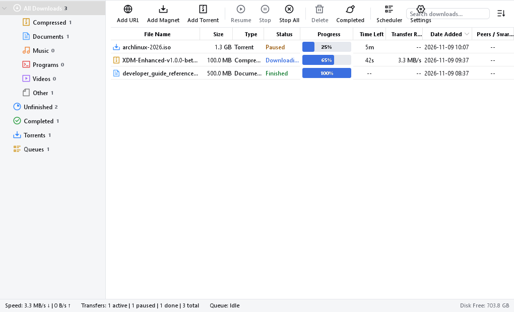
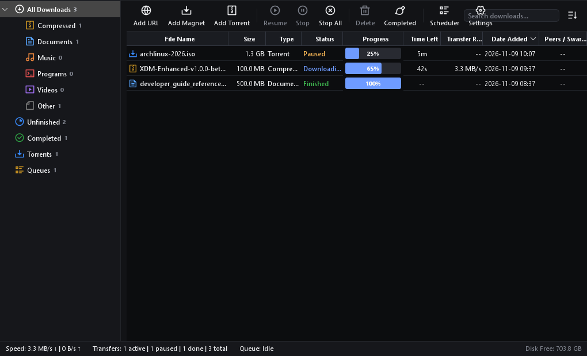
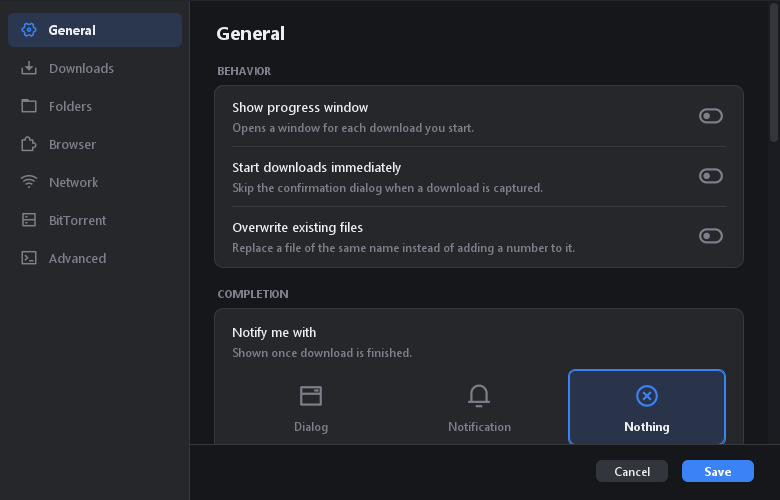
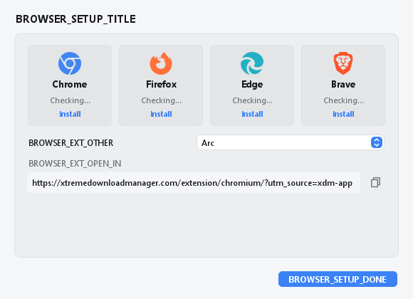
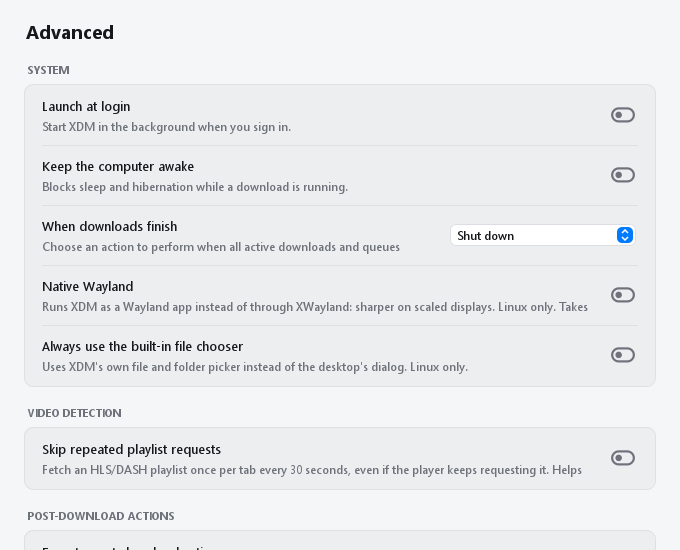

<p align="center">
  
</p>

# XDM Enhanced

**An independent, open-source download manager focused on reliability, usability, and extended functionality.**

<p align="center">
  <a href="https://github.com/jakepanlilio2000/XDM-Enhanced/releases"></a>
  <a href="https://github.com/jakepanlilio2000/XDM-Enhanced/releases"></a>
  
  <a href="LICENSE"></a>
  
</p>

---

## Table of Contents

- [1. Project Overview](#1-project-overview)
- [2. Features](#2-features)
- [3. Screenshots](#3-screenshots)
- [4. Downloads and Installation](#4-downloads-and-installation)
- [5. Browser Extension Installation](#5-browser-extension-installation)
- [6. Supported Platforms](#6-supported-platforms)
- [7. System Requirements](#7-system-requirements)
- [8. Getting Started](#8-getting-started)
- [9. Download Management](#9-download-management)
- [10. Browser Integration](#10-browser-integration)
- [11. Settings and Customization](#11-settings-and-customization)
- [12. Building from Source](#12-building-from-source)
- [13. Project Structure](#13-project-structure)
- [14. Known Issues](#14-known-issues)
- [15. Changelog](#15-changelog)
- [16. Reporting Bugs](#16-reporting-bugs)
- [17. Contributing](#17-contributing)
- [18. Acknowledgments](#18-acknowledgments)
- [19. License](#19-license)

---

## 1. Project Overview

**XDM Enhanced** is an independent, open-source desktop download manager forked from [Xtreme Download Manager (XDM)](https://github.com/subhra74/xdm). It combines XDM's multi-connection segmented HTTP/HTTPS download engine and streaming video grabber with native BitTorrent and magnet protocol support, advanced desktop theming, flexible post-download automation, power management upon completion, and overhauled companion browser extensions.

This project is independently maintained to provide ongoing stability, upstream bug fixes, modern desktop integration, and community feature requests while remaining strictly open source under the **GNU General Public License v3.0**.

The original upstream documentation is preserved in [README.UPSTREAM.md](README.UPSTREAM.md).

---

## 2. Features

### Accelerated HTTP/HTTPS Downloading
- **Multi-Connection Dynamic Segmentation:** Divides downloads into configurable concurrent connections that write directly into the destination file without a separate temporary copy or slow disk-assembly step.
- **Resumable Transfers:** Automatically recovers broken or interrupted downloads caused by connection dropouts, network timeouts, or power failures.
- **Refresh Download Links:** Refreshes expired temporary URLs and re-authenticates without restarting the download from the beginning.
- **Bandwidth Management:** Configurable global and per-task transfer speed caps to prevent network saturation.

### Native BitTorrent and Magnet Engine
- **Full BitTorrent 1.2 & 2.0 Support:** Powered by `libtorrent4j` wrapping the native `libtorrent` (Rasterbar) engine.
- **Magnet Link Resolution:** Background retrieval of torrent metadata for `magnet:?` URIs before downloading starts.
- **Selective File Inspection:** Multi-file pre-download dialog with hierarchical tree navigation, individual file checkboxes, and priority settings (*Do Not Download*, *Normal*, *High*, *Maximum*).
- **Tracker & Peer Management:** UDP/HTTP tracker communication, manual tracker addition, force reannounce, and live peer transfer inspection (IP address, client software, flags, encryption status, and live speeds).
- **Decentralized Discovery:** Distributed Hash Table (DHT), Peer Exchange (PEX), and Local Service Discovery (LSD), with strict BEP 27 adherence for private torrents.
- **Configurable Seeding Rules:** Automated termination of seeding based on ratio targets (e.g., 1.0x) or elapsed duration thresholds.

### Video Stream Detection & Muxing
- **Adaptive Stream Grabber:** One-click interception of HLS (`.m3u8`) and MPEG-DASH (`.mpd`) video streams directly in web browsers.
- **Direct MP4 Muxing:** Converts fragmented streaming audio and video segments directly into clean MP4 files without requiring an external FFmpeg installation.
- **Subtitle Extraction:** Automatically extracts and converts embedded WebVTT subtitles into timed `.srt` format.

### Desktop Experience & Dynamic Theming
- **High-Density Desktop UI:** Traditional desktop layout featuring a 7-category navigation sidebar (*All Downloads*, *Compressed*, *Documents*, *Music*, *Programs*, *Video*, *Torrents*), toolbar controls, sortable data table, and real-time disk storage status bar.
- **Dynamic Look & Feel (FlatLaf):** Instant appearance switching across Light, Dark, and System modes without requiring an application restart.
- **Accent Color Customization:** Six curated palette presets (*Blue*, *Cyan*, *Green*, *Amber*, *Purple*, *Rose*), custom hex color picker, and instant reset-to-default.
- **Drag-and-Drop File Handoff:** Drag completed downloads directly from the download table into Windows Explorer, media players, or external programs.

### Workflow Automation & Power Controls
- **Post-Download Action Rules:** Automated execution of user-configured commands upon file completion based on file extension matching. Supports variable interpolation (`%file%`, `%file_name%`, `%file_extension%`, `%file_directory%`, `%absolute_file_path%`, `%absolute_directory_path%`) with execution safety validation.
- **Completion Power Management:** Configurable system action when all downloads finish: *Do nothing*, *Sleep / Suspend*, *Shutdown*, or *Hibernate*, with a 30-second cancellable countdown warning.

### Companion Browser Extensions
- **Dual Platform Targets:** Native Manifest V3 service-worker extension for Chromium-based browsers and Manifest V2 background extension for Mozilla Firefox.
- **Website Exclusions:** "Block this site" exclusion rules with hostname normalization and wildcard subdomain matching (`*.example.com`).
- **Tokenized Multi-Keyword Filters:** Multi-term keyword filtering in the bulk link grabber with token chips, case-insensitivity, regex support, and configurable AND/OR evaluation.
- **Modern Options Dashboard:** Dedicated 6-tab settings interface covering General monitoring, Detection rules, Exclusions, Keyword filters, Appearance, and System Information.

---

## 3. Screenshots

### Main Application Window

| Light Theme | Dark Theme |
| :---: | :---: |
|  |  |

### Desktop Settings & Customization

| Appearance & Accent Customization | Browser Integration Settings |
| :---: | :---: |
|  |  |

| Post-Download Action Rules | Completion Action Configuration |
| :---: | :---: |
|  |  |

### Browser Integration & Media Grabbing

| Extension Video Stream Detection | Bulk Download Link Grabber |
| :---: | :---: |
|  |  |

---

## 4. Downloads and Installation

Pre-compiled packages and release assets are available on the [GitHub Releases page](https://github.com/jakepanlilio2000/XDM-Enhanced/releases).

### Release Assets

| Package | Format | Architecture | Description |
| :--- | :---: | :---: | :--- |
| **Windows Installer** | `.exe` | Windows x64 | Full NSIS installer with bundled Liberica JDK 25, native libraries, AppCDS startup cache, shortcuts, and uninstaller. |
| **Windows Standalone** | `.zip` | Windows x64 | Portable application directory (`xdm-app.exe` + trimmed JRE runtime) requiring no system installation. |
| **Universal Java App** | `.jar` | Any (64-bit) | Platform-independent fat JAR (`xdm-app.jar`) requiring a local 64-bit Java Runtime Environment 25. |
| **Chromium Extension** | `.zip` | Chromium MV3 | Companion extension for Google Chrome, Microsoft Edge, Brave, Opera, and Vivaldi. |
| **Firefox Extension** | `.zip` | Firefox MV2 | Companion extension for Mozilla Firefox, Floorp, and LibreWolf. |
| **Source Code** | `.zip` / `.tar.gz` | All | Full project source code tree. |

### Windows Installation (NSIS Setup)
1. Download `XDM-Enhanced-Setup-v<version>-win-x64.exe` from the latest release.
2. Run the installer. By default, it supports both per-user (`%LOCALAPPDATA%\Programs\XDM Enhanced`) and machine-wide (`%ProgramFiles%\XDM Enhanced`) installation scopes.
3. Select your desired desktop shortcuts, Start Menu entry, and file associations (`.torrent` and `magnet:`).
4. Launch **XDM Enhanced** from the Start Menu or Desktop shortcut.

### Portable Windows Bundle
1. Download `XDM-Enhanced-v<version>-windows-x64.zip`.
2. Extract the archive to any folder.
3. Run `xdm-app.exe`. All application files and the bundled runtime remain self-contained.

---

## 5. Browser Extension Installation

To intercept downloads and capture streaming web videos, install the companion browser extension.

```
┌─────────────────────────────────┐           ┌─────────────────────────────────┐
│     Web Browser (Extension)     │   HTTP    │    XDM Enhanced Desktop App     │
│   Chrome / Edge / Firefox       ├──────────►│      Loopback: 127.0.0.1:8597   │
│   Video sniffer & bulk grabber  │◄──────────┤   Segmented downloader & engine │
└─────────────────────────────────┘           └─────────────────────────────────┘
```

### Chromium Browsers (Google Chrome, Microsoft Edge, Brave, Opera, Vivaldi)

1. Download `XDM-Enhanced-Extension-Chromium-v<version>.zip` from GitHub Releases.
2. Extract the archive into a dedicated folder (e.g., `Documents\XDM-Extension-Chrome`).
3. Open your browser and navigate to `chrome://extensions` (or `edge://extensions` in Edge).
4. Enable the **Developer mode** toggle in the top-right corner.
5. Click **Load unpacked** in the top-left toolbar.
6. Select the folder where you extracted the extension.
7. The extension will activate immediately with the name **XDM Enhanced - Browser Integration**.

### Mozilla Firefox (Firefox, Floorp, LibreWolf)

#### Temporary Add-on Loading (Standard Firefox)
1. Download `XDM-Enhanced-Extension-Firefox-v<version>.zip` from GitHub Releases.
2. In Firefox, navigate to `about:debugging#/runtime/this-firefox`.
3. Click **Load Temporary Add-on…**.
4. Select the downloaded `.zip` file (or the `manifest.json` inside the extracted folder).
5. The extension will load with extension ID `xdm-enhanced-browser-monitor@jakepanlilio2000.github.io`.

#### Persistent Installation (Firefox Developer Edition / Nightly)
1. Open `about:config` and set `xpinstall.signatures.required` to `false`.
2. Drag and drop `XDM-Enhanced-Extension-Firefox-v<version>.zip` into the Firefox window to install persistently.

### Extension Signing & Distribution Notice
Standalone beta packages are distributed as ZIP archives intended for developer-mode and sideloaded testing. Public store packages submitted through the Chrome Web Store and Mozilla Add-on Developer Hub will be announced once store reviews are complete.

---

## 6. Supported Platforms

| Operating System | Architecture | BitTorrent Engine | Status |
| :--- | :---: | :---: | :--- |
| **Windows 10 / 11** | `x64` (`amd64`) | `libtorrent4j.dll` | Fully Verified (Primary Target) |
| **Windows 11 on ARM** | `arm64` | `libtorrent4j.dll` (x64 under emulation) | Supported |
| **Linux** (Ubuntu, Fedora, Arch, etc.) | `x64` (`amd64`) | `liblibtorrent4j.so` | Supported (Bundled native binaries) |
| **macOS** (macOS 11+) | `x64` & `arm64` | `liblibtorrent4j.dylib` | Supported (Bundled native binaries) |

*Note: 32-bit Windows (x86) is deprecated upstream by libtorrent4j and is not supported.*

---

## 7. System Requirements

### Hardware
- **Processor:** 64-bit dual-core CPU or faster (`x86_64` or `arm64`).
- **Memory:** 512 MB available RAM minimum (1 GB recommended for large concurrent downloads).
- **Storage:** 150 MB free disk space for the application and bundled runtime.

### Software
- **Windows:** Windows 10 (Build 17134+) or Windows 11 64-bit.
- **Linux:** Modern 64-bit Linux distribution with GLIBC 2.27 or higher, X11 or Wayland (with XWayland).
- **macOS:** macOS 11 (Big Sur) or higher.
- **Java Runtime:** Pre-packaged in the Windows installer and standalone bundle. For universal JAR usage, a 64-bit **Java Runtime Environment (JRE) 25** is required.

---

## 8. Getting Started

1. **Launch the Application:** Start XDM Enhanced from your Start Menu, Desktop shortcut, or terminal (`java -jar xdm-app.jar`).
2. **First-Run Configuration:**
   - XDM Enhanced creates an isolated user data directory at `%APPDATA%\xdm-enhanced` (Windows) or `~/.xdm-enhanced` (Linux/macOS), ensuring no interference with existing official XDM installations.
   - If an existing upstream XDM configuration is detected, XDM Enhanced safely imports settings without modifying the original database.
3. **Connect Your Browser:** Open **Settings → Browser Settings** to verify integration status and install companion extensions.
4. **Choose Your Theme:** Navigate to **Settings → Appearance** to select your preferred theme mode (*System*, *Light*, or *Dark*) and accent color.

---

## 9. Download Management

### Adding Downloads
- **Direct URLs:** Click **Add URL** on the toolbar, paste a file link, and click **Download Now**.
- **BitTorrent Files:** Click **Add Torrent** or drag a `.torrent` file directly into the application window.
- **Magnet URIs:** Click **Add Magnet**, paste a `magnet:?xt=...` URI, and inspect the retrieved file tree.
- **Browser Interception:** Downloads clicked in your web browser are automatically captured and routed into XDM Enhanced.

### Selective Torrent File Downloading
When adding a torrent or magnet link, a pre-download inspection dialog appears:
- Check or uncheck individual files or entire folders.
- Right-click files to assign priorities: *Do Not Download*, *Normal*, *High*, or *Maximum*.
- Adjust destination directory and queue placement before commencing download.

### Transfer Controls & Queue Management
- **Pause & Resume:** Use toolbar buttons or context menu shortcuts to pause active transfers and resume later.
- **Queue Reordering:** Move tasks up, down, to top, or to bottom to prioritize bandwidth allocation.
- **Drag-and-Drop Handoff:** Once a download finishes, simply drag its row from the download table into Windows Explorer, a desktop folder, or another application to copy or open the file.
- **Clean Downloads:** Click **Delete** or the Clear dialog to remove entries from history. Destructive deletion of actual files from disk requires explicit confirmation.

---

## 10. Browser Integration

XDM Enhanced runs an internal HTTP communication endpoint bound strictly to local loopback (`127.0.0.1:8597`).

```
                               ┌────────────────────────┐
                               │  Browser Context Menu  │
                               ├────────────────────────┤
                               │ Download with XDM      │
                               │ Download Image with XDM│
                               │ Download all with XDM… │
                               └───────────┬────────────┘
                                           │
                                           ▼
┌──────────────────────┐        ┌──────────────────────┐        ┌──────────────────────┐
│  Browser Extension   ├───────►│ 127.0.0.1:8597 (IPC) ├───────►│ XDM Enhanced Engine  │
│  Popup & Monitoring  │◄───────┤ State & Batch API    │◄───────┤ Download Manager     │
└──────────────────────┘        └──────────────────────┘        └──────────────────────┘
```

- **Video Stream Interception:** When playing streaming media on video websites, the extension badge indicates detected streams. Click the toolbar icon to download any available resolution.
- **Bulk Link Grabber:** Press `Alt+Shift+D` or choose *Download all with XDM Enhanced…* from the page context menu to open the bulk grabber. Filter links using categories, wildcards (`*.mp4`), or tokenized keywords.
- **Website Exclusions:** Choose *Block this site* from the extension popup to pause browser monitoring on sensitive websites, banking portals, or intranets.
- **Security Protections:** The integration endpoint enforces DNS-rebinding protection, loopback binding, and origin verification (`chrome-extension://` and `moz-extension://`).

---

## 11. Settings and Customization

Access application preferences via the **Settings** toolbar icon or `Tools → Settings`:

- **Folders & Storage:** Configure default destination folders and category-specific download paths (*Compressed*, *Documents*, *Music*, *Programs*, *Video*, *Torrents*).
- **Appearance & Accent Chooser:** Select *Light*, *Dark*, or *System* appearance modes. Pick an accent color from presets (*Blue*, *Cyan*, *Green*, *Amber*, *Purple*, *Rose*) or choose a custom hex color.
- **Post-Download Action Rules:** Create automated rules triggered by file extensions (`.zip`, `.mkv`, `.iso`, etc.) executing custom commands with variable substitutions.
- **Completion Actions:** Configure power management when all active downloads finish (*Do nothing*, *Sleep*, *Shutdown*, *Hibernate*) with an abortable countdown timer.
- **Network & Limits:** Set global concurrent connection limits, maximum active torrent transfers, and bandwidth rate caps.

---

## 12. Building from Source

### Prerequisites
- **Java Development Kit:** 64-bit [JDK 25](https://bell-sw.com/pages/downloads/#jdk-25) (e.g., BellSoft Liberica Standard JDK 25 or OpenJDK 25).
- **Build Tool:** [Apache Maven 3.9](https://maven.apache.org/) or higher.
- **Git:** Git 2.30 or higher.
- **Windows Packaging (Optional):** [NSIS 3.10+](https://nsis.sourceforge.io/) for generating `.exe` setup installers.

### Compilation Steps

1. **Clone the repository:**
   ```bash
   git clone https://github.com/jakepanlilio2000/XDM-Enhanced.git
   cd XDM-Enhanced
   ```

2. **Compile all modules and package the universal JAR:**
   ```bash
   mvn clean package -DskipTests
   ```
   The compiled fat JAR is output to:
   `xdm-app/target/xdm-app.jar`

3. **Run the automated test suite:**
   ```bash
   mvn test -DskipTests=false
   ```

### Packaging Windows Releases

To generate the standalone Windows x64 runtime image and NSIS setup installer:

```powershell
# 1. Produce standalone JRE runtime bundle (app-image)
powershell -ExecutionPolicy Bypass -File packaging\build-bundle.ps1 -Type app-image -Arch x64 -SkipBuild

# 2. Compile NSIS Setup Installer
powershell -ExecutionPolicy Bypass -File packaging\build-bundle.ps1 -Type nsis -Arch x64 -SkipBuild
```

The resulting installer is saved to:
`build\dist\windows-x64\XDM-Enhanced-Setup-v<version>-win-x64.exe`

### Packaging Browser Extensions

To validate and package the Chromium and Firefox companion extensions:

```powershell
powershell -ExecutionPolicy Bypass -File browser-extension\package-extensions.ps1
```

The validated release ZIP archives are output to:
`build\dist\extensions\`

---

## 13. Project Structure

```
XDM-Enhanced/
├── xdm-app/                 # Swing desktop application, UI, theming, settings, and lifecycle
│   ├── src/main/java/       # Kotlin and Java desktop UI implementations
│   └── src/main/resources/  # Localization (lang/), theme configurations, version metadata
├── xdm-core/                # Multi-connection segmented HTTP/HTTPS download engine
│   └── src/main/java/       # Core protocol handling, HLS/DASH demuxer, direct MP4 muxer
├── xdm-capture/             # Browser integration HTTP server and media request sniffer
├── xdm-torrent/             # Native BitTorrent integration via libtorrent4j and libtorrent
├── xdm-manager/             # Task scheduling, queue management, and database persistence
├── browser-extension/       # Companion browser extensions
│   ├── chrome-extension/   # Manifest V3 extension for Chromium-based browsers
│   ├── firefox-extension/  # Manifest V2 extension for Mozilla Firefox
│   └── package-extensions.ps1 # Extension validation and zip packaging automation
├── packaging/               # Packaging scripts and platform bundles
│   ├── windows/             # NSIS installer script (xdm-installer.nsi), WiX (xdm.wxs)
│   ├── linux/               # Linux .desktop launcher, icons, packaging specs
│   └── build-bundle.ps1     # Native Windows JLink runtime and bundle automation
├── screenshots/             # Application screenshots and visual assets
├── CHANGELOG.md             # Detailed release history and migration notes
├── LICENSE                  # GNU General Public License v3.0 text
├── README.md                # Main project documentation (this file)
└── README.UPSTREAM.md       # Preserved original upstream XDM documentation
```

---

## 14. Known Issues

- **32-Bit Systems:** 32-bit x86 architectures are deprecated upstream by `libtorrent4j` and are not supported.
- **Unsigned Extension Packages:** Standalone beta `.zip` extension archives require enabling Developer Mode in Chromium or temporary add-on loading in Firefox.
- **IPv6 Trackers:** Pure IPv6-only torrent trackers in environments without DHT support require dual-stack network connectivity.

---

## 15. Changelog

Detailed notes on all versions are documented in [CHANGELOG.md](CHANGELOG.md).

- **v1.0.0-beta.2 (Current Release):** Post-download action rules engine, download completion power actions (sleep, shutdown, hibernate), drag-and-drop file handoff, browser extension "Block this site" exclusions and multi-keyword filtering, clickable desktop browser settings tiles, NSIS setup installer, and folder persistence fixes.
- **v1.0.0-beta.1:** Initial independent release adding native BitTorrent and magnet downloading, FlatLaf dynamic theming (Light, Dark, System modes), customizable accent color palettes, high-density desktop toolbar, storage meter, and isolated application configuration directories.

---

## 16. Reporting Bugs

If you encounter an issue or unexpected behavior:

1. Check existing issues on the [Issue Tracker](https://github.com/jakepanlilio2000/XDM-Enhanced/issues) to avoid duplicates.
2. Open a new issue providing:
   - Operating system and version (e.g., Windows 11 23H2, Ubuntu 24.04).
   - XDM Enhanced version (e.g., `v1.0.0-beta.2`).
   - Browser name and extension version (if reporting browser integration issues).
   - Clear steps to reproduce the problem and relevant log snippets from `%APPDATA%\xdm-enhanced\log.txt` (Windows) or `~/.xdm-enhanced/log.txt` (Linux/macOS).

---

## 17. Contributing

Contributions are welcome! To contribute:

1. Fork the repository on GitHub.
2. Create a feature branch: `git checkout -b feature/my-feature`.
3. Commit your changes with clear, descriptive commit messages.
4. Run the automated test suite to ensure no regressions: `mvn test -DskipTests=false`.
5. Push to your branch and submit a Pull Request.

All contributions are licensed under the **GNU General Public License v3.0**.

---

## 18. Acknowledgments

XDM Enhanced is built on the foundation of the original **Xtreme Download Manager (XDM)** project. We gratefully acknowledge:

- **Subhra Das Gupta ([subhra74](https://github.com/subhra74))** — Creator of the original Xtreme Download Manager, segmented download architecture, and media capture engine.
- **Alden Torres & the FrostWire Team** — Authors and maintainers of `libtorrent4j`.
- **Arvid Norberg** — Author and maintainer of native `libtorrent` (Rasterbar).
- **FormDev Software GmbH** — Creators of the `FlatLaf` Swing look-and-feel library.
- **Upstream Contributors & Issue Reporters** whose feedback guided specific improvements in this release:
  - Issue [#1426](https://github.com/subhra74/xdm/issues/1426) — Download folder persistence
  - Issue [#1417](https://github.com/subhra74/xdm/issues/1417) — Clear dialog preferences
  - Issue [#1395](https://github.com/subhra74/xdm/issues/1395) — Accent color customization
  - Issue [#1349](https://github.com/subhra74/xdm/issues/1349) — System theme mode
  - Issue [#1383](https://github.com/subhra74/xdm/issues/1383) — Drag completed downloads
  - Issue [#1406](https://github.com/subhra74/xdm/issues/1406) — Website exclusions & keyword filters
  - Issues [#1391](https://github.com/subhra74/xdm/issues/1391) & [#1372](https://github.com/subhra74/xdm/issues/1372) — Compact browser settings tiles (browser extension UI refresh concept inspired by contributor Abhishek Mallav, [@abhishekmallav](https://github.com/abhishekmallav))
  - Issue [#1409](https://github.com/subhra74/xdm/issues/1409) — Post-download action rules
  - Issue [#1430](https://github.com/subhra74/xdm/issues/1430) — Completion action options
  - Issue [#1412](https://github.com/subhra74/xdm/issues/1412) — Linux desktop integration

For original upstream project details, see [README.UPSTREAM.md](README.UPSTREAM.md).

---

## 19. License

XDM Enhanced is free, open-source software licensed under the **GNU General Public License v3.0 (GPL-3.0)**.

```
Copyright (C) 2013-2026 Subhra Das Gupta and upstream contributors
Copyright (C) 2026 XDM Enhanced Contributors

This program is free software: you can redistribute it and/or modify
it under the terms of the GNU General Public License as published by
the Free Software Foundation, either version 3 of the License, or
(at your option) any later version.

This program is distributed in the hope that it will be useful,
but WITHOUT ANY WARRANTY; without even the implied warranty of
MERCHANTABILITY or FITNESS FOR A PARTICULAR PURPOSE. See the
GNU General Public License for more details.

You should have received a copy of the GNU General Public License
along with this program. If not, see <https://www.gnu.org/licenses/>.
```

### Third-Party Software Notices
- **libtorrent4j:** MIT License (Copyright © Alden Torres)
- **libtorrent (Rasterbar):** BSD 3-Clause License (Copyright © Arvid Norberg)
- **FlatLaf:** Apache License 2.0 (Copyright © FormDev Software GmbH)
- **Conscrypt:** Apache License 2.0 (Copyright © The Android Open Source Project)
- **KotlinX Serialization:** Apache License 2.0 (Copyright © JetBrains s.r.o.)
