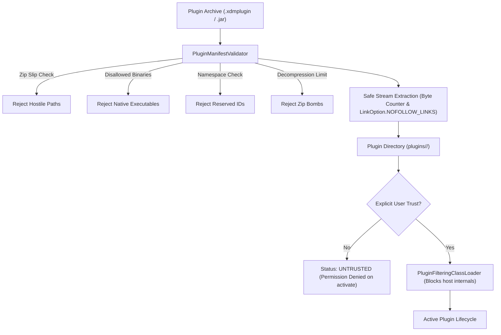

# XDM Enhanced — Plugin Security & Transparent Trust Model

**Document Version:** 1.0.0  
**Scope:** Security Posture, Trust Model, and Technical Boundaries for Plugin SDK v2  
**Target Release:** `v1.1.0-beta.1` / `xdm-plugin-api:2.0.0`  

---

## 1. Fundamental Trust Principle

### In-Process Execution Reality
> [!IMPORTANT]
> **In-process Java plugins run inside the XDM Enhanced process with the full operating system privileges of the application user.**  
> Manifest capability declarations coordinate application features, UI contribution points, and SPI routing; **manifest permissions alone CANNOT sandbox them.**

In modern Java (Java 17+ and Java 21+ following JEP 411), the legacy Java `SecurityManager` has been deprecated and terminally degraded. Any attempt to claim that in-process Java code is "sandboxed" or "restricted from filesystem/network access" by manifest declarations alone would be technically false and misleading to users.

XDM Enhanced adopts an **honest and transparent security posture**:
1. Users must treat installing a third-party plugin with the same caution as installing any executable software.
2. The host application provides strict **cooperative boundaries**, **ClassLoader filtering**, **archive validation**, **path containment**, and **fault recovery**, but does not present these safeguards as a bulletproof OS sandbox.
3. Third-party plugins require **explicit user approval** at install time and start in an `UNTRUSTED` state.

---

## 2. Technical Boundaries & Defenses

While in-process JVM execution shares user privileges, XDM Enhanced enforces concrete technical barriers to prevent accidental damage, namespace collision, path traversal, and malicious package extraction:

### 2.1 Archive & Package Validation (`PluginManifestValidator`)
Before any archive is unpacked:
- **Zip Slip & Traversal Protection:** Every entry path is normalized and inspected. Entries with `..`, leading slashes (`/`), Windows drive separators (`:`), or home-directory references (`~`) are rejected immediately.
- **Symlink & Directory Junction Prohibition:** Symlink entries and directory junctions are strictly forbidden. Decompression uses `LinkOption.NOFOLLOW_LINKS` and verifies that no destination path is a symbolic link.
- **Decompression Streaming Limits (Zip Bomb Defense):** 
  - Maximum entry count: 1,000 files.
  - Maximum single entry uncompressed size: 25 MB (`MAX_ENTRY_BYTES`).
  - Maximum total uncompressed archive size: 50 MB (`MAX_UNCOMPRESSED_BYTES`).
  - **Streaming byte counters** enforce limits during actual decompression, neutralizing forged ZIP header metadata.
- **Executable File Blacklist:** Direct native executable binaries and shell scripts (`.exe`, `.dll`, `.so`, `.dylib`, `.bat`, `.cmd`, `.sh`, `.ps1`, `.vbs`, `.js`, `.py`, `.bin`, `.com`, `.scr`, `.msi`, `.appimage`, `.cpl`, `.hta`, `.wsf`, `.reg`, `.pif`) are rejected from plugin archives.
- **Reserved Namespace Protection:** Manifest identifiers matching reserved names (`core`, `app`, `system`, `xdm`, `builtin`, `manager`, `torrent`, `http`, `api`, `config`, `settings`, `root`, `admin`, `null`, `con`, `prn`, `aux`) are rejected to prevent impersonation of core subsystems.

### 2.2 ClassLoader Filtering Boundary (`PluginFilteringClassLoader`)
- Third-party plugins are loaded into an isolated child `URLClassLoader`.
- The parent classloader is restricted to the public `xdm.plugin.api.*` interfaces and standard Java runtime classes.
- Direct reflection or linkage against internal application classes (`xdm.app.*`, `xdm.core.*`, `xdm.manager.*`) throws `ClassNotFoundException`.

### 2.3 Safe Argument Handling & Subprocess Execution
For capabilities that interact with external tools (such as `yt-dlp` or post-download shell actions):
- Process execution uses array-based arguments directly with `ProcessBuilder(argv)`.
- No intermediate shell (`cmd.exe /c` or `/bin/sh -c`) is invoked, eliminating shell metacharacter injection.
- CLI argument separators (`--`) are inserted where applicable to prevent flag injection from untrusted download URLs.

### 2.4 Separately Executed Adapters & Isolation Realism
Where external CLI tools are integrated:
- The external process runs as a child process of the user's desktop session.
- Because true OS-level containerization (e.g. cgroups/namespaces on Linux or AppContainer on Windows) requires root/admin setup or specialized container engines not present on typical user desktops, **XDM Enhanced explicitly documents this capability as "process-managed" rather than "sandboxed."**

---

## 3. Install-Time Disclosure & Explicit User Approval

### 3.1 Install-Time Disclosure Prompt
When a user installs or enables a plugin, XDM Enhanced presents a comprehensive security disclosure dialog displaying:
1. **Source Package:** File path and package name.
2. **Identity & Origin:** Plugin name, ID, author, and homepage.
3. **Version & License:** Declared version and software license.
4. **API Compatibility:** Declared minimum API version vs. current host API version.
5. **Requested Capabilities:** Clear listing of declared SPI facets (e.g., `DOWNLOAD_PROVIDER`, `POST_DOWNLOAD_PROCESSOR`, `NETWORK_PROXY`, `EVENT_BUS`).
6. **Cryptographic Checksum:** Computed SHA-256 hash.
7. **In-Process Warning:**
   > "⚠️ IN-PROCESS EXECUTION WARNING: In-process Java plugins run inside the XDM Enhanced process with your full user account privileges. Manifest permissions alone cannot sandbox them. Only approve plugins from publishers you know and trust."

### 3.2 Permission Denial Invariant
- Plugins newly extracted or discovered on disk start in `PluginStatus.UNTRUSTED`.
- Any direct attempt to call `PluginManager.activatePlugin` on an untrusted plugin fails immediately:
  $$\text{activatePlugin(untrusted)} \implies \text{false}, \quad \text{status} = \text{UNTRUSTED}, \quad \text{faultReason} = \text{"Permission denied: plugin has not received explicit user approval."}$$
- Code execution is strictly blocked until the user explicitly confirms approval via `trustAndEnablePlugin`.

---

## 4. Cryptographic Checksum & Signature Limitations

### What SHA-256 Checksums Guarantee
- **Integrity:** Verifies that the `.xdmplugin` archive has not suffered byte-level corruption or in-transit alteration.
- **Repeatability:** Ensures that the archive inspected by the validator is identical to the archive extracted to disk.

### What Checksums Do NOT Guarantee
- **Publisher Authenticity:** A raw SHA-256 checksum does not prove *who* wrote the code.
- **Safety / Benign Intent:** A perfectly valid checksum does not indicate that the code is free of bugs, telemetry, or hostile logic.
- Users must evaluate developer reputation and repository source rather than relying solely on checksum presence.

---

## 5. Local-Only Communication Boundaries

- **Zero Remote Exposure:** Plugin API services, event buses (`PluginEventBus`), and host context facades (`PluginHostContext`) communicate strictly in-memory within the local JVM.
- **No Unauthenticated Remote APIs:** No server sockets, remote procedure call (RPC) listeners, or public listening ports are opened by plugins or the plugin framework.
- **Browser Integration:** Native messaging and loopback HTTP communication (`127.0.0.1`) remain restricted to the core application browser integration and are not directly exposed to third-party plugin modification.

---

## 6. Incident Recovery & Safe Mode Quarantine

### Automated Circuit Breaker
- If the application crashes during startup due to a faulty or conflicting plugin, an internal counter records consecutive startup failures in `.crash-recovery.json`.
- Upon reaching **3 consecutive startup crashes**, the application triggers **Automatic Safe Mode**.

### Safe Mode (`--safemode`)
- In Safe Mode, **all third-party plugins are unconditionally quarantined and disabled** (`PluginStatus.DISABLED`).
- No plugin entry points or background threads are initialized.
- Users can launch the Settings $\rightarrow$ Plugins panel to diagnose fault logs, disable offending extensions, or cleanly uninstall problematic packages.

---

## 7. User Data Boundaries & Privacy

- **Private Storage:** Each plugin receives a private data directory under `plugins/<pluginId>/data`.
- **Data Preservation:** During plugin upgrades or reinstallation, existing data in `data/` is backed up and restored automatically.
- **Uninstall Options:** When uninstalling, users are prompted whether to completely delete all data or preserve settings in `.preserved-data/<pluginId>`.
- **Diagnostic Logging Redaction:** System diagnostics and error logs redact sensitive tokens and credentials (e.g. proxy user/pass, HTTP authorization headers) before displaying them in UI tabs or writing to log files.
