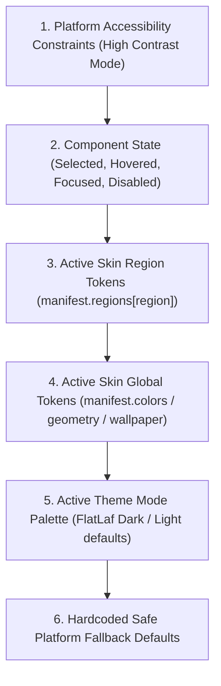

# XDM Enhanced — Custom Skin Development SDK & Specification (Schema Version 2)

Welcome to the **XDM Enhanced Skin Development SDK**. This guide provides complete documentation for modders, UI designers, and theme developers to create, test, package, and distribute custom visual skins for **XDM Enhanced**.

---

## Table of Contents

1. [Overview & Architectural Principles](#1-overview--architectural-principles)
2. [Operating System Boundaries](#2-operating-system-boundaries)
3. [Package Format (`.xdmskin`)](#3-package-format-xdmskin)
4. [Manifest Schema (`skin.json`)](#4-manifest-schema-skinjson)
   - [Schema Versioning & Compatibility](#schema-versioning--compatibility)
   - [Full Example Manifest](#full-example-manifest)
   - [Root Manifest Fields Reference](#root-manifest-fields-reference)
5. [Semantic UI Regions Contract](#5-semantic-ui-regions-contract)
   - [Supported Region Slots](#supported-region-slots)
   - [Region Configuration Properties](#region-configuration-properties)
6. [Style Resolution & Precedence Hierarchy](#6-style-resolution--precedence-hierarchy)
7. [Built-in Skins & Asset Provenance](#7-built-in-skins--asset-provenance)
   - [Original XDM Skin (`classic_xdm`)](#original-xdm-skin-classic_xdm)
   - [XDM Enhanced Skin (`enhanced`)](#xdm-enhanced-skin-enhanced)
8. [Customization Capabilities](#8-customization-capabilities)
   - [Component Arcs & Geometry](#component-arcs--geometry)
   - [Accents & Color Palettes](#accents--color-palettes)
   - [Window Wallpapers & Backgrounds](#window-wallpapers--backgrounds)
   - [Custom Typography & Fonts](#custom-typography--fonts)
   - [Category & Toolbar Icons](#category--toolbar-icons)
   - [FlatLaf UI Defaults](#flatlaf-ui-defaults)
9. [Security, Sandboxing & Validation Rules](#9-security-sandboxing--validation-rules)
10. [Validating Skins with the CLI Tool](#10-validating-skins-with-the-cli-tool)
11. [Installing, Exporting & Managing Skins via UI](#11-installing-exporting--managing-skins-via-ui)
12. [Step-by-Step Tutorial: Creating a Custom Skin](#12-step-by-step-tutorial-creating-a-custom-skin)
13. [Sample Skin: Cyber Neon](#13-sample-skin-cyber-neon)

---

## 1. Overview & Architectural Principles

XDM Enhanced features a declarative, sandboxed skinning engine inspired by classic extensible desktop applications like Winamp, modernized with Java Swing and FlatLaf.

### Core Principles

- **No Executable Code:** Skins cannot execute Java bytecode, shell scripts, or native libraries. All styling is declared via JSON and standard media assets.
- **Dynamic Hot-Reloading:** Skins switch instantly across all active frames and modals without requiring an application restart and without disrupting active file transfers.
- **Strict Precedence:** The authoritative resolver (`SkinStyleResolver`) guarantees consistent styling while strictly respecting system accessibility requirements (such as high contrast modes).
- **Graceful Failure Recovery:** If a custom skin manifest is invalid, corrupt, or unreadable, the application logs diagnostics and safely falls back to the default `XDM Enhanced` skin.
- **Cross-Platform Consistency:** `.xdmskin` packages work uniformly across Windows, Linux, and macOS.

---

## 2. Operating System Boundaries

The XDM Enhanced skin system controls the **application-rendered client area** across all main frames and modal dialogs. However, certain interface elements are governed directly by the host operating system window manager and cannot be universally styled by application skins:

1. **Native OS Title Bars & Window Borders:**
   - On Windows (DWM), macOS (Cocoa), and Linux (Wayland / X11 window managers like GNOME Shell or KWin), the top window caption, system minimize/maximize/close buttons, and outer drop shadows are rendered by the OS window manager.
   - When FlatLaf window decorations are enabled (`FlatLaf.useWindowDecorations`), FlatLaf styles the title bar on supported platforms; however, native OS accessibility overrides or Wayland limitations may force standard system title bars.
2. **Native File Choosers (`java.awt.FileDialog`):**
   - Standard operating system open/save file pickers are delegated directly to the OS shell for native desktop integration and file previewing. These dialogs are styled by the host OS, not the XDM skin engine.
3. **OS Security & Elevation Dialogs (UAC / Polkit):**
   - System credential prompts, User Account Control (UAC) dialogs on Windows, and Polkit authentication prompts on Linux are privileged operating system boundaries and cannot be modified or intercepted by application skins.

---

## 3. Package Format (`.xdmskin`)

A custom skin package is a standard ZIP archive using the `.xdmskin` extension.

### Directory Layout

```text
my-skin.xdmskin
├── skin.json                         # Required: Root manifest definition
├── backgrounds/                      # Optional: Wallpaper & background images
│   ├── wallpaper-dark.png
│   ├── wallpaper-light.png
│   └── progress-bg.png
├── icons/                            # Optional: Custom icon replacements
│   ├── categories/
│   │   ├── documents.png
│   │   ├── compressed.png
│   │   ├── music.png
│   │   ├── videos.png
│   │   ├── programs.png
│   │   ├── images.png
│   │   ├── torrents.png
│   │   └── all.png
│   └── toolbar/
│       ├── add.png
│       ├── resume.png
│       ├── pause.png
│       ├── delete.png
│       └── settings.png
├── fonts/                            # Optional: TrueType (.ttf) or OpenType (.otf) fonts
│   └── custom-font.ttf
└── styles/                           # Optional: Documentation, license, or readme
    └── README.md
```

---

## 4. Manifest Schema (`skin.json`)

### Schema Versioning & Compatibility

- **`schemaVersion: 1` (Legacy):** Base skin model supporting global colors, geometry, wallpapers, and icons. Fully backward-compatible.
- **`schemaVersion: 2` (Current):** Introduces component-level and regional modal styling via the `regions` block, providing granular control over all 13 application UI zones. If `schemaVersion` is omitted, the engine defaults to `1`.

### Full Example Manifest

```json
{
  "schemaVersion": 2,
  "id": "cyber-neon",
  "name": "Cyber Neon",
  "version": "1.0.0",
  "author": "XDM Enhanced Team",
  "description": "High-contrast cyberpunk visual theme with glowing neon cyan accents, custom category icons, wallpapers, full-UI modal styling, and dark grid aesthetics.",
  "minAppVersion": "1.0.0-beta.4",
  "license": "GPL-3.0-or-later",
  "homepage": "https://github.com/jakepanlilio2000/XDM-Enhanced",
  "geometry": {
    "componentArc": 12,
    "buttonArc": 10,
    "popupArc": 12,
    "rowHeight": 28,
    "sidebarWidth": 220,
    "toolbarIconSize": 20,
    "categoryIconSize": 18
  },
  "accents": {
    "dark": "#00F0FF",
    "light": "#0284C7",
    "selection": "#00F0FF"
  },
  "colors": {
    "dark": {
      "windowBackground": "#0B0E14",
      "panelBackground": "#0E121A",
      "sidebarBackground": "#07090D",
      "sidebarBorder": "#1E293B",
      "sidebarForeground": "#E0F7FA",
      "sidebarSelectedForeground": "#00F0FF",
      "sidebarSelectionBackground": "#162338",
      "sidebarHoverBackground": "#101826",
      "listBackground": "#0B0E14",
      "listTitleForeground": "#E0F7FA",
      "listSelectionBackground": "#162338",
      "listHoverBackground": "#101826"
    },
    "light": {
      "windowBackground": "#F0F4F8",
      "panelBackground": "#FFFFFF",
      "sidebarBackground": "#E2E8F0",
      "sidebarBorder": "#CBD5E1",
      "sidebarForeground": "#0F172A",
      "sidebarSelectedForeground": "#0284C7",
      "sidebarSelectionBackground": "#BAE6FD",
      "sidebarHoverBackground": "#E0F2FE",
      "listBackground": "#FFFFFF",
      "listTitleForeground": "#0F172A",
      "listSelectionBackground": "#E0F2FE",
      "listHoverBackground": "#F0F9FF"
    }
  },
  "wallpaper": {
    "dark": "backgrounds/cyber-dark.png",
    "light": "backgrounds/cyber-light.png",
    "mode": "fill",
    "opacity": 0.15
  },
  "layout": {
    "toolbarPosition": "top",
    "sidebarPosition": "left",
    "showStatusBar": true,
    "showSearchBar": true
  },
  "font": {
    "family": "Inter",
    "path": "fonts/Inter-Regular.ttf",
    "size": 13
  },
  "icons": {
    "categories": {
      "documents": "icons/categories/documents.png",
      "compressed": "icons/categories/compressed.png",
      "music": "icons/categories/music.png",
      "videos": "icons/categories/videos.png",
      "programs": "icons/categories/programs.png",
      "images": "icons/categories/images.png",
      "torrents": "icons/categories/torrents.png",
      "all": "icons/categories/all.png"
    },
    "toolbar": {
      "ADD_URL": "icons/toolbar/add.png",
      "RESUME": "icons/toolbar/resume.png",
      "STOP": "icons/toolbar/pause.png",
      "DELETE": "icons/toolbar/delete.png",
      "SETTINGS": "icons/toolbar/settings.png"
    }
  },
  "regions": {
    "main_frame": {
      "background": "#0B0E14",
      "cornerArc": 12,
      "buttonArc": 10
    },
    "toolbar": {
      "height": 42,
      "buttonArc": 10,
      "cornerArc": 10
    },
    "sidebar": {
      "width": 220,
      "background": "#07090D",
      "cornerArc": 10
    },
    "download_list": {
      "height": 32,
      "cardArc": 10,
      "background": "#0B0E14"
    },
    "download_modal": {
      "background": "#0E121A",
      "cornerArc": 14,
      "buttonArc": 10
    },
    "video_download_modal": {
      "background": "#0E121A",
      "cornerArc": 14,
      "buttonArc": 10
    },
    "progress_modal": {
      "background": "#0E121A",
      "cornerArc": 14,
      "buttonArc": 10,
      "progressBarArc": 10
    },
    "torrent_modal": {
      "background": "#0E121A",
      "cornerArc": 14,
      "buttonArc": 10
    },
    "settings": {
      "background": "#0B0E14",
      "cornerArc": 14,
      "buttonArc": 10
    },
    "plugin_manager": {
      "cornerArc": 14,
      "buttonArc": 10,
      "cardArc": 10
    },
    "about": {
      "background": "#0B0E14",
      "cornerArc": 16,
      "buttonArc": 10
    },
    "dialogs": {
      "background": "#131720",
      "cornerArc": 12,
      "buttonArc": 10
    },
    "tooltips_popups": {
      "cornerArc": 10,
      "background": "#131720",
      "foreground": "#00F0FF"
    }
  },
  "uiDefaults": {
    "Component.arc": 12,
    "Button.arc": 10,
    "TextComponent.arc": 12,
    "ScrollBar.showButtons": true
  }
}
```

### Root Manifest Fields Reference

| Field | Type | Required | Description |
| :--- | :---: | :---: | :--- |
| `schemaVersion` | Integer | No | Schema revision: `1` (legacy base) or `2` (full-UI regional styling). Defaults to `1`. |
| `id` | String | **Yes** | Unique identifier matching `^[a-z0-9_-]{3,32}$`. Built-ins (`enhanced`, `classic_xdm`) are reserved. |
| `name` | String | **Yes** | Human-readable theme display name (1 to 64 chars). |
| `version` | String | **Yes** | Semantic version string (e.g., `1.0.0`). |
| `author` | String | No | Author or creator name. |
| `description` | String | No | Theme summary and aesthetic overview. |
| `minAppVersion` | String | No | Minimum compatible XDM Enhanced version (e.g., `1.0.0-beta.4`). |
| `license` | String | No | SPDX license identifier (e.g., `GPL-3.0-or-later`, `MIT`). |
| `homepage` | String | No | URL to skin documentation or source repository. |
| `attributionNotice` | String | No | Upstream copyright or asset attribution notice. |
| `geometry` | Object | No | Global UI radii and component dimensions. |
| `accents` | Object | No | Primary accent colors in `#RRGGBB` format. |
| `colors` | Object | No | Palette overrides for dark and light modes. |
| `wallpaper` | Object | No | Global background image configuration and scaling mode. |
| `layout` | Object | No | Main frame layout positions (toolbar, sidebar, status bar). |
| `font` | Object | No | Bundled TrueType or OpenType font definition. |
| `icons` | Object | No | Relative paths to category and toolbar icon replacements. |
| `regions` | Object | No | Schema 2 regional overrides for all 13 UI zones. |
| `uiDefaults` | Object | No | Arbitrary FlatLaf UI property overrides. |

---

## 5. Semantic UI Regions Contract

Schema Version 2 provides granular control over individual UI surfaces through semantic region slots.

### Supported Region Slots

| Region Slot ID | Semantic UI Area | Target Window / Component |
| :--- | :--- | :--- |
| `main_frame` | Main Window Interior | Root window panel, frame background, central layout |
| `toolbar` | Action Toolbar | Top or bottom toolbar container and tool buttons |
| `sidebar` | Category Sidebar | Navigation tree/list of download categories |
| `download_list` | Download Table / Cards | Primary download queue table and card view |
| `download_modal` | Standard Download Dialog | New URL download modal dialog |
| `video_download_modal` | Video Download Dialog | Video stream quality and audio selector modal |
| `progress_modal` | Download Progress Window | Active file transfer progress window |
| `torrent_modal` | Torrent / Magnet Dialog | BitTorrent metadata inspector and file selection |
| `settings` | Preferences Modal | Multi-tab application configuration dialog |
| `plugin_manager` | Plugin Manager | Plugin registry, installation and settings dialog |
| `about` | About Dialog | Application credits, license, and system info |
| `dialogs` | General Dialogs | Confirmation, alert, prompt, and error dialogs |
| `tooltips_popups` | Tooltips & Context Menus | Hover tooltips, dropdown menus, and context popups |

### Region Configuration Properties

Each region in `manifest.regions` can override the following properties:

| Property | Type | Range / Format | Description |
| :--- | :---: | :---: | :--- |
| `background` | String | `#RRGGBB` | Region background fill color. |
| `foreground` | String | `#RRGGBB` | Primary text and foreground color. |
| `mutedForeground` | String | `#RRGGBB` | Secondary or muted label color. |
| `border` | String | `#RRGGBB` | Line or border stroke color. |
| `borderWidth` | Integer | `0` to `16` px | Border stroke thickness. |
| `cornerArc` | Integer | `0` to `48` px | Corner radius for the region container. |
| `buttonArc` | Integer | `0` to `48` px | Corner radius for action buttons inside the region. |
| `cardArc` | Integer | `0` to `48` px | Corner radius for cards or nested surfaces. |
| `progressBarArc` | Integer | `0` to `48` px | Corner radius for progress indicators in the region. |
| `padding` | Object | `{top, left, bottom, right}` | Padding insets (each `0` to `64` px). |
| `wallpaper` | Object | `{dark, light, mode, opacity}` | Region-specific background wallpaper configuration object. |
| `customIcon` | String | Relative file path | Region-specific icon asset. |
| `height` | Integer | `20` to `800` px | Preferred or constrained height for the region. |
| `width` | Integer | `20` to `800` px | Preferred or constrained width for the region. |

---

## 6. Style Resolution & Precedence Hierarchy

All component styling is governed by the authoritative `SkinStyleResolver`. When resolving colors, corner radii, or wallpapers for any UI component, the engine strictly evaluates the following deterministic precedence:



1. **Platform Accessibility Constraints:** If the operating system or user activates a High Contrast theme, accessibility tokens take immediate precedence over custom skin colors to ensure WCAG compliance.
2. **Component State:** Dynamic interaction states (hover, selection, pressed, focused, disabled) calculate appropriate contrast adjustments from the base token.
3. **Active Skin Region Tokens:** Region-specific definitions (e.g. `regions.progress_modal.background`) override global skin tokens within that region.
4. **Active Skin Global Tokens:** Global skin definitions (e.g. `colors.dark.windowBackground`, `geometry.buttonArc`) apply across all regions unless specifically overridden.
5. **Active Theme Mode Palette:** Standard FlatLaf Dark or Light palette tokens apply when a skin does not specify a custom color.
6. **Hardcoded Safe Platform Defaults:** Safe fallback constants ensure components remain visible and functional even with minimal or partially defined skins.

---

## 7. Built-in Skins & Asset Provenance

XDM Enhanced includes two production-grade built-in skins with distinct design identities:

### Original XDM Skin (`classic_xdm`)
- **Design Philosophy:** Faithful tribute to the classic Xtreme Download Manager UI.
- **Visual Attributes:**
  - Strict **zero-arc corners** (`cornerArc = 0`, `buttonArc = 0`, `progressBarArc = 0`) across all frames, modals, and buttons.
  - Classic industrial color palette: `#2B2B2B` window background, `#1E1E1E` sidebar background, and `#007ACC` classic blue accents.
  - Original toolbar button heights and rectangular tab geometry.
- **Asset Provenance:**
  - Classic toolbar and category icons are preserved from original upstream XDM (GPL-3.0-or-later) and loaded from `xdm.app.skins.BuiltInClassicXdmSkin`.
  - Zero proprietary or non-free assets.

### XDM Enhanced Skin (`enhanced`)
- **Design Philosophy:** Modern, ergonomic macOS-inspired FlatMac interface.
- **Visual Attributes:**
  - Refined **8px corner radii** across buttons, panels, cards, and progress bars.
  - High-DPI crisp vector icons powered by RemixIcon.
  - Subtle semi-transparent selection surfaces and card borders.
  - Full support for system light/dark mode auto-switching.

---

## 8. Customization Capabilities

### Component Arcs & Geometry
Fine-tune corner rounding:
- `geometry.componentArc`: Global corner radius for panels and cards (`0` to `48` px).
- `geometry.buttonArc`: Global corner radius for buttons (`0` to `48` px).
- `geometry.popupArc`: Corner radius for menus, tooltips, and popups (`0` to `48` px).
- `geometry.rowHeight`: Download table and list row height (`20` to `60` px).
- `geometry.sidebarWidth`: Category navigation sidebar width (`120` to `400` px).

### Accents & Color Palettes
Define distinct color palettes for light and dark modes:
- `accents.dark`: Hex color for active indicators, primary buttons, and progress fills in dark mode.
- `accents.light`: Hex color for light mode.
- `colors.dark.windowBackground`: Window root container background.
- `colors.dark.sidebarBackground`: Navigation sidebar background.
- `colors.dark.panelBackground`: Card and modal background surfaces.
- `colors.dark.listTitleForeground`: Download title text color.
- `colors.dark.listSelectionBackground`: Selected item highlight fill.

### Window Wallpapers & Backgrounds
Skins can paint subtle textures or artwork across the main window or specific modals:
- `mode`:
  - `fill`: Stretches image to cover the container while preserving aspect ratio.
  - `fit`: Scales image to fit completely within container dimensions.
  - `tile`: Seamlessly repeats pattern across horizontal and vertical space.
  - `center`: Centers image at original dimensions without scaling.
- `opacity`: Alpha blending level from `0.0` (transparent) to `1.0` (opaque). Recommended: `0.05` to `0.20` to maintain high text contrast and legibility.

### Custom Typography & Fonts
Bundle TrueType (`.ttf`) or OpenType (`.otf`) fonts in the `fonts/` directory:
```json
"font": {
  "family": "Inter",
  "path": "fonts/Inter-Regular.ttf",
  "size": 13
}
```
Fonts are loaded securely in-memory via `Font.createFont` without requiring host system installation.

### Category & Toolbar Icons
Map category IDs and action keys to custom PNG/JPG/WebP/GIF icons:

#### Category Icon Keys
`documents`, `compressed`, `music`, `videos`, `programs`, `images`, `torrents`, `all`

#### Toolbar Action Keys
`ADD_URL`, `ADD_MAGNET`, `ADD_TORRENT`, `RESUME`, `STOP`, `STOP_ALL`, `DELETE`, `DELETE_COMPLETED`, `SCHEDULER`, `SETTINGS`, `SORT`

### FlatLaf UI Defaults
Inject raw FlatLaf styling variables directly into `UIManager`:
```json
"uiDefaults": {
  "Component.arc": 12,
  "Button.arc": 10,
  "TextComponent.arc": 12,
  "ScrollBar.thumbArc": 6
}
```

---

## 9. Security, Sandboxing & Validation Rules

XDM Enhanced enforces strict automated verification when installing or parsing skins:

1. **Zip Slip Prevention:** File paths containing directory traversal (`..`) or absolute path roots (`/`, `C:\`) are strictly rejected.
2. **Decompression Bomb Protection:**
   - Maximum entry count: **500 entries**.
   - Maximum uncompressed total size: **50 MB**.
   - Maximum single entry size: **15 MB**.
3. **Executable Code Prohibition:** Archives containing executable or script extensions are unconditionally rejected:
   - Binaries: `.exe`, `.dll`, `.so`, `.dylib`
   - Bytecode: `.class`, `.jar`, `.dex`
   - Shell scripts: `.bat`, `.cmd`, `.ps1`, `.vbs`, `.sh`, `.bash`, `.zsh`
   - Scripting languages: `.js`, `.py`, `.rb`, `.pl`
4. **Permitted File Formats:**
   - Manifest: `skin.json`
   - Images: `.png`, `.jpg`, `.jpeg`, `.gif`, `.webp`
   - Fonts: `.ttf`, `.otf`
   - Documentation: `.txt`, `.md`
5. **Manifest Constraints:**
   - `id`: Must match `^[a-z0-9_-]{3,32}$`. Reserved IDs (`enhanced`, `classic_xdm`) cannot be overwritten.
   - `schemaVersion`: Must be `1` or `2`.
   - Numeric constraints: Arcs clamped between `0` and `48` px; padding between `0` and `64` px; dimensions between `20` and `800` px.
   - Hex colors: Must match `#RRGGBB` format.

---

## 10. Validating Skins with the CLI Tool

XDM Enhanced provides a standalone command-line validator for development and automated CI pipelines:

### Usage

```bash
java -cp xdm-app/target/xdm-app.jar xdm.app.skins.SkinValidatorCli <path-to-xdmskin-or-folder>
```

### Example Output

```text
==================================================
VALIDATION PASSED: Cyber Neon (cyber-neon)
Schema:      Version 2
Version:     1.0.0
Author:      XDM Enhanced Team
Min App:     1.0.0-beta.4
License:     GPL-3.0-or-later
Regions:     13 declared (main_frame, toolbar, sidebar, download_list, download_modal, video_download_modal, progress_modal, torrent_modal, settings, plugin_manager, about, dialogs, tooltips_popups)
Arcs:        Component=12px, Button=10px
Row Height:  28px
Sidebar W:   220px
Toolbar Pos: top
Sidebar Pos: left
==================================================
```

### Exit Codes
- `0`: Valid package, passed all security and schema checks.
- `1`: Invalid package. Diagnostic errors are written to standard error.

---

## 11. Installing, Exporting & Managing Skins via UI

### To Install a Skin:
1. Open XDM Enhanced.
2. Navigate to **Settings** (`Tools → Settings` or gear icon) and select **Appearance**.
3. In the **Skins & Themes** section, click **Install Skin...**.
4. Select any `.xdmskin` package. The package is validated, installed into the user's `skins/` directory, and immediately added to the skin selector.
5. Click **Apply Skin** to activate it across all open windows.

### To Export a Custom Skin:
1. In **Appearance Settings**, select your custom skin from the dropdown.
2. Click **Export Skin...**.
3. Choose the target destination (`<skin-name>.xdmskin`).

### To Delete a Custom Skin:
1. Select the custom skin from the dropdown.
2. Click **Delete Skin** and confirm. Built-in skins cannot be deleted.

---

## 12. Step-by-Step Tutorial: Creating a Custom Skin

### Step 1: Initialize Skin Directory
```bash
mkdir my-custom-skin
cd my-custom-skin
mkdir backgrounds icons fonts
```

### Step 2: Create `skin.json`
```json
{
  "schemaVersion": 2,
  "id": "my-custom-skin",
  "name": "My Custom Skin",
  "version": "1.0.0",
  "author": "Designer Name",
  "minAppVersion": "1.0.0-beta.4",
  "accents": {
    "dark": "#8B5CF6",
    "light": "#7C3AED"
  },
  "regions": {
    "main_frame": {
      "background": "#0F172A",
      "cornerArc": 12
    },
    "progress_modal": {
      "background": "#1E293B",
      "progressBarArc": 8,
      "buttonArc": 8
    }
  }
}
```

### Step 3: Validate with CLI
```bash
java -cp xdm-app/target/xdm-app.jar xdm.app.skins.SkinValidatorCli ./my-custom-skin
```

### Step 4: Package Archive
```bash
zip -r ../my-custom-skin.xdmskin ./*
```

---

## 13. Sample Skin: Cyber Neon

The complete working reference implementation for Schema Version 2 is available in the repository:
- Unpacked Source: [`sample-skins/cyber-neon/`](../sample-skins/cyber-neon/)
- Packaged Binary: [`sample-skins/cyber-neon.xdmskin`](../sample-skins/cyber-neon.xdmskin)
